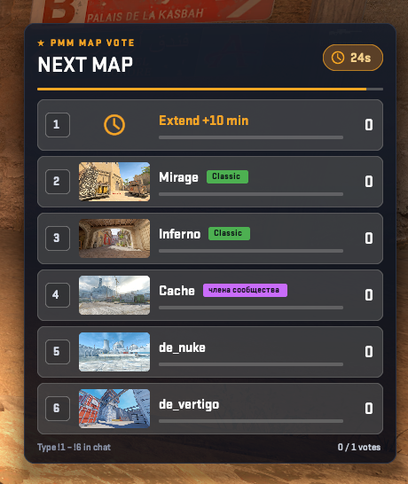
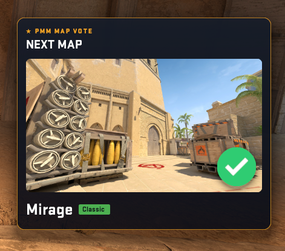

# PMM_GG1MapChooser

<h2><a href="https://genesis-cs.space/menuconstructor/index.html">>>>Более подробная информация на сайте<<<</a></h2>




Bridge by **Rimmer** between [GG1MapChooser](https://github.com/ssypchenko/GG1MapChooser) 1.8.1 and [PanoramaMenuManager](https://github.com/RRimmer/PanoramaMenuManagerCS2) (MenuManagerCS2 1.2.05). GG1MapChooser is not changed: Harmony patches its WASD menu classes at runtime.

Current version: **0.1.0**. Needs CounterStrikeSharp 1.0.376 (.NET 10), GG1MapChooser 1.8.1 and PMM Core (MenuManagerCS2) 1.2.05 (1.2.03+ works without the digits mode).

- Every GG1 WASD menu (admin maps, yes/no vote) opens in MenuManager.
- `!nominate` is its own panorama list in the same style: map pictures from CS2, badges, "nominated" / "yours" / "recently played", 6 maps per page.
- The end-of-map vote is its own panorama panel: map picture, name, badge, vote bar, counter, "your vote", timer and "N / M votes".
  Four vote modes, per player: mouse (click), WASD (the player can walk, W / S + E), digits (number keys 1–9, PMM Core 1.2.05) and chat (`!1 … !N`). Position left, center or right.
  The result is a tick on the winning row or a next-map card.
- The round in which GG1 starts the vote gets a longer `mp_freezetime`. The old value comes back after the vote.

## Repository layout

| Folder | What it is |
| --- | --- |
| `PMM_GG1MapChooser` | The plugin: `Plugin.cs` (Harmony, GG1 → MenuManager), `Hud.cs` (one HUD entity for three panels), `Players.cs` (vote modes, input, settings), `MapVote.cs` (vote panel), `Nominate.cs` (nominate panel), `Freeze.cs` (freeze time), `MapsCss.cs` (map pictures CSS), `Config.cs` |
| `tools/gen_layout.py` | Writes `pmm_mapvote.xml` (row counts must match the plugin) |
| `PMM_GG1MapChooser/panorama` | Client files for the MultiAddonManager addon: `pmm_mapvote.xml`, `pmm_mapvote.css`, `pmm_mapvote_maps.css` |
| `PMM_GG1MapChooser/lib` | `0Harmony.dll` (Lib.Harmony 2.4.2, net10.0) |
| `PMM_GG1MapChooser/lang` | Translations `ru.json`, `en.json`: every panel text and chat message, per player language |
| `MenuManagerApi` | Compile-time library (PMM Core 1.2.05 API). Do not copy `MenuManagerApi.dll` next to this plugin |
| `configs` | Example config |

## Install from a Release

Copy `Server-plugins/counterstrikesharp` into `game/csgo/addons/`. You get:

- `plugins/PMM_GG1MapChooser/PMM_GG1MapChooser.dll`
- `plugins/PMM_GG1MapChooser/harmony/0Harmony.dll`
- `plugins/PMM_GG1MapChooser/lang/ru.json`, `lang/en.json`
- `configs/plugins/PMM_GG1MapChooser/PMM_GG1MapChooser.json`

`0Harmony.dll` stays only in `harmony/`. A copy next to the plugin DLL breaks the patches ("Resolving to a collectible assembly is not supported"). Restart the server after an install or update: `css_plugins reload` does not unload Harmony.

In the GG1 config set `EndMapVoteMenuMode`, `NominationsMenuMode` and `PoolVoteSettings.MenuMode` to `"Wasd"`. For the freeze time keep `TriggerRoundsBeforeEndVoteAtRoundStart: true` and `TriggerVoteAtRoundStartSecondsFromStart: 0`.

Copy `Content-addonmanager/panorama` into the MultiAddonManager addon and rebuild it in Workshop Tools. Updating from 0.0.3 or older: `pmm_mapvote.xml` and `pmm_mapvote.css` changed, rebuild the addon.

Official maps use the CS2 screenshots. For other maps put a PNG into `panorama/images/custom_game/maps/` in the addon and set `"Image": "maps/name.png"` in `Maps`. The plugin writes `pmm_mapvote_maps.css` next to its DLL (`css_pmm_gg1 css`); copy it into the addon and rebuild.

## Vote mode

Each player has a mode for the vote and the nominate panel:

1. their own choice in the vote settings (`!vm` or the gear chip in the panel header),
2. else their `!menu`, unless it is the default mouse panorama (WASD menus → WASD, chat → chat, PanoramaDigitMenu / CSGO Menu → digits),
3. else `Vote.DefaultMode` (`mouse`, `wasd`, `digits`, `chat`).

| Mode | Vote | Nominate |
| --- | --- | --- |
| Mouse | cursor, click | click, ‹ › pages, × close |
| WASD | walk; W / S, E vote, R settings | W / S, A / D pages, E pick, R close |
| Digits | 1–9 vote, 0 settings | 1–6 map, 8 / 9 pages, 0 close |
| Chat | `!1 … !N` | the core's chat menu |

Digits need the PMM Core number keys check; picking digits in the settings starts it. The vote setting does not change `!menu`. Choices are saved in `plugins/PMM_GG1MapChooser/vote_modes.json`. `ForceMenuType` now only affects the ordinary GG1 menus.

Texts are not in the config: `lang/ru.json` and `lang/en.json` (each player sees their own language, `!lang`). For another language copy `en.json` to `<code>.json`.

Server console: `css_pmm_gg1` (status), `css_pmm_gg1 repatch`, `css_pmm_gg1 css`.

## Build

You need the .NET 10 SDK.

```bash
dotnet build PMM_GG1MapChooser.sln --configuration Release
```

Output: `PMM_GG1MapChooser/bin/Release/net10.0/`. Ship `PMM_GG1MapChooser.dll` and `harmony/0Harmony.dll`. Do not ship `CounterStrikeSharp.API.dll` or `MenuManagerApi.dll`.

The changelog is in [CHANGELOG.md](CHANGELOG.md).

## License

[GNU GPL v3](LICENSE).

---

# PMM_GG1MapChooser

<h2><a href="https://genesis-cs.space/menuconstructor/index.html">>>>Более подробная информация на сайте<<<</a></h2>

Мост от **Rimmer** между [GG1MapChooser](https://github.com/ssypchenko/GG1MapChooser) 1.8.1 и [PanoramaMenuManager](https://github.com/RRimmer/PanoramaMenuManagerCS2) (MenuManagerCS2 1.2.05). GG1MapChooser не меняется: Harmony патчит его WASD-меню в рантайме.

Текущая версия: **0.1.0**. Нужен CounterStrikeSharp 1.0.376 (.NET 10), GG1MapChooser 1.8.1 и PMM Core (MenuManagerCS2) 1.2.05 (с 1.2.03+ работает всё, кроме режима «Цифры»).

- Любое WASD-меню GG1 (админ-карты, голосование да/нет) открывается в MenuManager.
- `!nominate` — своя панорама в том же стиле: картинки карт из CS2, метки, «номинирована» / «твоя» / «недавно играли», 6 карт на странице.
- Голосование в конце карты — отдельная панорамная панель: картинка карты, название, бейдж, полоса голосов, счётчик, «твой голос», таймер и «N / M голосов».
  Четыре режима голосования, у каждого игрока свой: мышь (клик), WASD (игрок ходит, W / S + E), цифры (клавиши 1–9, PMM Core 1.2.05) и чат (`!1 … !N`). Позиция слева, по центру или справа.
  Результат — галочка на победившей строке или карточка следующей карты.
- Раунд, в котором GG1 запускает голосование, получает увеличенный `mp_freezetime`. Старое значение возвращается после голосования.

## Что лежит в репозитории

| Папка | Зачем |
| --- | --- |
| `PMM_GG1MapChooser` | Плагин: `Plugin.cs` (Harmony, GG1 → MenuManager), `Hud.cs` (одна сущность HUD на три панели), `Players.cs` (режимы, ввод, настройки), `MapVote.cs` (голосование), `Nominate.cs` (номинация), `Freeze.cs` (freeze time), `MapsCss.cs` (CSS картинок карт), `Config.cs` |
| `tools/gen_layout.py` | Пишет `pmm_mapvote.xml` (число строк совпадает с плагином) |
| `PMM_GG1MapChooser/panorama` | Клиентские файлы для аддона MultiAddonManager: `pmm_mapvote.xml`, `pmm_mapvote.css`, `pmm_mapvote_maps.css` |
| `PMM_GG1MapChooser/lib` | `0Harmony.dll` (Lib.Harmony 2.4.2, net10.0) |
| `PMM_GG1MapChooser/lang` | Переводы `ru.json`, `en.json`: все надписи панелей и сообщения в чат, на языке игрока |
| `MenuManagerApi` | Библиотека только для сборки (API PMM Core 1.2.05). `MenuManagerApi.dll` рядом с этим плагином не клади |
| `configs` | Пример конфига |

## Установка с Release

`Server-plugins/counterstrikesharp` копируется в `game/csgo/addons/`. Получится:

- `plugins/PMM_GG1MapChooser/PMM_GG1MapChooser.dll`
- `plugins/PMM_GG1MapChooser/harmony/0Harmony.dll`
- `plugins/PMM_GG1MapChooser/lang/ru.json`, `lang/en.json`
- `configs/plugins/PMM_GG1MapChooser/PMM_GG1MapChooser.json`

`0Harmony.dll` лежит только в `harmony/`. Копия рядом с DLL плагина ломает патчи («Resolving to a collectible assembly is not supported»). После установки или обновления полностью перезапусти сервер: `css_plugins reload` не выгружает Harmony.

В конфиге GG1 поставь `EndMapVoteMenuMode`, `NominationsMenuMode` и `PoolVoteSettings.MenuMode` в `"Wasd"`. Для freeze time оставь `TriggerRoundsBeforeEndVoteAtRoundStart: true` и `TriggerVoteAtRoundStartSecondsFromStart: 0`.

`Content-addonmanager/panorama` копируется в аддон MultiAddonManager и собирается в Workshop Tools. При обновлении с 0.0.3 и раньше изменились `pmm_mapvote.xml` и `pmm_mapvote.css` — аддон нужно пересобрать.

Официальные карты используют скриншоты CS2. Для остальных карт положи PNG в `panorama/images/custom_game/maps/` в аддоне и укажи `"Image": "maps/name.png"` в `Maps`. Плагин пишет `pmm_mapvote_maps.css` рядом со своей DLL (`css_pmm_gg1 css`); скопируй его в аддон и пересобери.

## Режим голосования

У каждого игрока свой режим для голосования и панели номинации:

1. выбранный им в настройках голосования (`!vm` или кнопка с шестерёнкой в шапке панели),
2. иначе его `!menu`, если там не стандартная панорама с мышью (WASD-меню → WASD, чат → чат, «Панорама (цифры)» / CSGO Menu → цифры),
3. иначе `Vote.DefaultMode` (`mouse`, `wasd`, `digits`, `chat`).

| Режим | Голосование | Номинация |
| --- | --- | --- |
| Мышь | курсор, клик | клик, ‹ › страницы, × закрыть |
| WASD | можно ходить; W / S, E — голос, R — настройки | W / S, A / D страницы, E выбрать, R закрыть |
| Цифры | 1–9 голос, 0 настройки | 1–6 карта, 8 / 9 страницы, 0 закрыть |
| Чат | `!1 … !N` | меню ядра в чате |

Для цифр нужна проверка клавиш PMM Core: выбор «Цифры» в настройках сам её запускает. Настройка голосования не меняет `!menu`. Выбор хранится в `plugins/PMM_GG1MapChooser/vote_modes.json`. `ForceMenuType` теперь действует только на обычные меню GG1.

Текстов в конфиге нет: они в `lang/ru.json` и `lang/en.json` (каждый игрок видит свой язык, `!lang`). Для другого языка скопируй `en.json` в `<код>.json`.

Консоль сервера: `css_pmm_gg1` (статус), `css_pmm_gg1 repatch`, `css_pmm_gg1 css`.

## Сборка

Нужен .NET 10 SDK.

```bash
dotnet build PMM_GG1MapChooser.sln --configuration Release
```

Результат: `PMM_GG1MapChooser/bin/Release/net10.0/`. В поставку входят `PMM_GG1MapChooser.dll` и `harmony/0Harmony.dll`. `CounterStrikeSharp.API.dll` и `MenuManagerApi.dll` не клади.

История изменений — в [CHANGELOG.md](CHANGELOG.md).

## Лицензия

[GNU GPL v3](LICENSE).